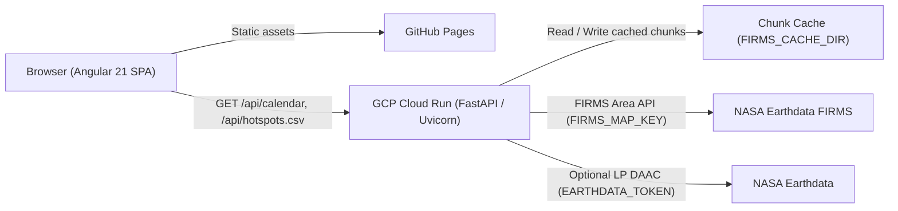

# NASA Wildfires Model — Harmonized MODIS & VIIRS Burning Activity Calendar

> **2026 NASA Space Apps Challenge:** *15 — Harmonization of MODIS and VIIRS Hot Spots*  
> Built by **KMD Labs** (`kmd-labs`)

An interactive **Burning Activity Calendar** and Earth Observation analytics web application that harmonizes more than two decades of active fire hotspot detections across **MODIS (Terra & Aqua, 1 km)** and **VIIRS (Suomi NPP, NOAA-20 & NOAA-21, 375 m)** into a single, consistent time series from **November 2000 to the present**.

---

## Table of Contents

- [The Challenge & Our Approach](#the-challenge--our-approach)
  - [Part 1: Cross-Sensor MODIS & VIIRS Harmonization (`backend/`)](#part-1-cross-sensor-modis--viirs-harmonization-backend)
  - [Part 2: Interactive Burning Activity Calendar (`src/`)](#part-2-interactive-burning-activity-calendar-src)
- [System Architecture (GitHub Pages + GCP Cloud Run)](#system-architecture-github-pages--gcp-cloud-run)
  - [Security & Public Architecture Considerations](#security--public-architecture-considerations)
- [Multi-Layer Caching & Offline Strategy](#multi-layer-caching--offline-strategy)
- [API Endpoints](#api-endpoints)
- [Local Development & Verification](#local-development--verification)

---

## The Challenge & Our Approach

Active-fire satellites have observed global burning for over 25 years, but **MODIS** (approaching end of operational life) and **VIIRS** cannot be compared directly: VIIRS operates at finer spatial resolution (`375 m` vs `1 km`), detects smaller/cooler fires, and flies on different orbital schedules with three satellites (`S-NPP`, `NOAA-20`, `NOAA-21`). A raw sum of detections creates an artificial step change whenever a new sensor joins.

Following the challenge's two-part structure, our system cleanly separates **statistical cross-sensor harmonization** from **interactive spatiotemporal exploration**:

### Part 1: Cross-Sensor MODIS & VIIRS Harmonization (`backend/`)

The harmonization pipeline expresses multi-satellite hotspot observations in consistent **MODIS-equivalent units** so historical patterns, seasonal regimes, and anomalies remain comparable from `2000-11` onward:

1. **Quality Assurance & Static Heat Masking:** Filters NASA FIRMS detections to presumed vegetation fires (`type == 0`), excludes low-confidence retrievals, and masks persistent industrial/gas-flare/volcanic heat sources (including 1-pixel spatial dilation for NRT geolocation jitter).
2. **Spatial & Temporal Aggregation:** Bins detections across all five platforms (`TERRA`, `AQUA`, `SNPP`, `NOAA20`, `NOAA21`) into **H3 hexagonal cells** and calendar months while tracking satellite overpass availability (`outage` detection).
3. **Sensing-Power Efficiency Model:** Models each platform's detection efficiency $e_{p,\text{cell},\text{month}}$ relative to MODIS using hierarchical shrinkage (`cell -> region & calendar month -> prior`) and divides observed counts by total active orbital sensing power:

   $$H_{\text{cell},\text{month}} = \frac{\sum_p N_{p,\text{cell},\text{month}}}{\sum_p \left(e_{p,\text{cell},\text{month}} \cdot \text{exposure}_{p,\text{month}}\right)}$$

   Selectable harmonization engines (`HARMONIZATION=v1|v2|v3` in `backend/harmonization_select.py`) extend the baseline model (`harmonization.py`) with day/night stratification, orbit-drift eras, Fire Radiative Power (FRP) intensity classes (`harmonization2.py`), and a separated small-fire explanatory layer (`harmonization3.py`).
4. **Uncertainty, Anomalies & Validation:** Computes 90% quasi-Poisson confidence intervals, leave-one-out multi-year seasonal baselines (anomaly Z-scores, percentiles, % of median), blocked $k$-fold out-of-sample cross-validation, and optional burned-area seam tests against NASA LP DAAC products (`MCD64A1` / `VNP64A1`).

### Part 2: Interactive Burning Activity Calendar (`src/`)

Built with **Angular 21**, **Three.js**, **D3-geo / TopoJSON**, and `@kmd/design-system`, the frontend provides an immediate full-viewport (`100vw × 100vh`) map/globe workspace:

- **Interactive Area of Interest (AOI) Selection:** Draw custom polygons/rectangles directly on the map/globe, enter exact `W / S / E / N` latitude-longitude bounds, or search pre-configured countries and seeded demo regions (defaulting to the Iberian Peninsula).
- **Sensor-Aware Date Range & 3-Way Switcher:** Query any range from `2000-11-01` onward with locale-aware date formatting. Switch between **VIIRS 375m**, **MODIS 1km**, and **VIIRS + MODIS**—automatically locking to **VIIRS + MODIS** (with explanatory tooltips) whenever a selected range spans the `2012-01-20` VIIRS launch.
- **Burning Activity Calendar:** Interactive Year × Month and Daily matrices alongside comparative time-series charts, top-year rankings, and multi-year anomaly readouts.
- **Accessible Visualization:** CVD-safe, high-contrast color ramps (Inferno, Viridis, Cividis, Plasma, Ember) driving both 2D/3D hotspot pixel heatmaps and calendar matrices.
- **Client Exports:** Export filtered/harmonized hotspots as **CSV**, full analytics payloads as **JSON**, and calendar graphics as **SVG** / **PNG**.

---

## System Architecture (GitHub Pages + GCP Cloud Run)

The application uses a split static-frontend / stateful-cache-backend architecture so public users get fast static delivery without exposing any NASA credentials:



- **Frontend (`GitHub Pages`):**
  - Built and deployed automatically on pushes to `main` (plus scheduled rebuilds) via [`.github/workflows/deploy.yml`](.github/workflows/deploy.yml) running `npm run build:gh-pages` (`ng build --base-href /nasa-wildfires-model/`).
  - Communicates over HTTPS `GET` requests with the backend URL configured in [`src/app/core/services/wildfire-data.service.ts`](src/app/core/services/wildfire-data.service.ts) (with `localStorage` / window override support for local development).
- **Backend (`Google Cloud Run`):**
  - Packaged via [`backend/Dockerfile`](backend/Dockerfile) (`python:3.12-slim` + `uvicorn backend.server:app`) and hosted in `europe-west1`.
  - Queries for new regions are split by satellite epoch into 5-day FIRMS Area API chunks (`FIRMS_CHUNK_DAYS=5`) aligned to a `0.5°` cache grid (`FIRMS_CACHE_DIR`): immutable science-quality chunks (`*_SP`) are cached permanently, while recent near-real-time chunks (`*_NRT`) refresh after `FIRMS_REFRESH_HOURS=6`.
  - Long initial historical downloads run asynchronously on the server and return **HTTP `202`** with `{ done, total }` progress until ready for **HTTP `200`** harmonization and analytics delivery.

### Security & Public Architecture Considerations

- **Publicly Inspectable Surface:** Publishing that the frontend lives on GitHub Pages and talks to Cloud Run does **not** introduce new exposure—browsers already resolve both hosts in network DevTools, and both the deployment workflow and `DEFAULT_HOSTED_API_BASE` live in client code.
- **Server-Only Credentials:** Sensitive credentials (`FIRMS_MAP_KEY`, `EARTHDATA_TOKEN`) are injected exclusively into the Cloud Run runtime environment and never bundled into the Angular build or GitHub repository.
- **Abuse Guardrails:** The API exposes read-only `GET` endpoints, enforces bounding-box area caps (`MAX_BBOX_DEG2 = 8000` deg² for FIRMS, `BURNED_AREA_MAX_DEG2 = 400` deg² for tile downloads), and validates CORS origins via `CORS_ORIGINS`.

---

## Multi-Layer Caching & Offline Strategy

Because 20+ years of FIRMS requests would otherwise trigger hundreds of upstream API calls and exceed rate limits, the application uses three complementary caching layers across backend and browser:

| Layer | Storage / Technology | What It Caches | Eviction / Freshness Rule |
|---|---|---|---|
| **1. Server FIRMS Chunk Cache** | Local filesystem (`FIRMS_CACHE_DIR/regions/<snapped_bbox>/`) in [`backend/firms.py`](backend/firms.py) | 5-day FIRMS sensor chunks (`FIRMS_CHUNK_DAYS=5`) aligned to an outwards `0.5°` grid (`snap_bbox`) | `*_SP` science-quality past chunks are **immutable/final** (`final=true`); recent `*_NRT` chunks refresh after `FIRMS_REFRESH_HOURS=6`. |
| **2. Browser Query & Upload Cache** | `IndexedDB` (`kmd-wildfires-offline`) in [`OfflineCacheService`](src/app/core/services/offline-cache.service.ts) | Harmonized `/api/calendar` JSON responses & user-uploaded custom CSV datasets | Up to `40` calendar queries (`MAX_CACHED_CALENDARS=40`) managed with `cachedAt` LRU eviction; custom CSV persists across reloads. |
| **3. Browser Shell & Basemap Tile Cache** | Service Worker `CacheStorage` in [`src/sw.js`](src/sw.js) | App shell (`kmd-wildfires-shell-v1`: HTML, bundled TopoJSON/default Iberia JSON) + slippy map tiles (`kmd-wildfires-tiles-v1`) | Up to `450` map tiles (`MAX_CACHED_TILES=450`) from `tile.openstreetmap.org` and `server.arcgisonline.com` evicted FIFO/LRU. |

How a request flows through the layers:

1. **Instant First Paint & Bundled Demo Snapshot:** Static bundled fallback JSON (`src/assets/data/default-iberia-calendar.json`) renders immediately while checking IndexedDB and live backend connectivity—meaning even zero-connectivity reloads remain functional.
2. **In-Memory + IndexedDB Lookup (`WildfireDataService`):** Query keys track bbox, date range, and `activeDataset`. Identical session requests hit the in-memory `Map` cache first; subsequent visits or offline sessions read cleanly from IndexedDB and surface an **"Offline cache"** indicator in the UI header.
3. **Snapped Regional Reuse on the Backend (`RegionCache`):** Any query contained inside an already-cached `0.5°`-snapped region satisfies sub-queries locally without hitting NASA FIRMS again. Live request traffic is favored over speculative global prewarming so background jobs never contend with user requests on the upstream FIRMS rate limiter; demo deployments can run `python -m backend seed` offline without an API key.

---

## API Endpoints

| Endpoint | Description |
|---|---|
| `GET /api/health` | Service health, cached regions list, and upstream key readiness |
| `GET /api/calendar?bbox=W,S,E,N&from=YYYY-MM&to=YYYY-MM` | `200` harmonized time series, calendar matrix, H3 cells, pixels, climatology, and validation metrics; `202` while chunk downloads are in progress |
| `GET /api/hotspots.csv?bbox=W,S,E,N&from=YYYY-MM-DD&to=YYYY-MM-DD` | Downloadable hotspot CSV (including `used_in_calendar` QA flag) |
| `GET /api/burned-area?bbox=W,S,E,N&product=MCD64A1&from=YYYY-MM&to=YYYY-MM` | Monthly burned area (km²) and cross-sensor seam check (requires server-side `EARTHDATA_TOKEN`) |

---

## Local Development & Verification

### 1. Backend Setup (Python 3.12+)

```bash
pip install -r backend/requirements.txt

# Optional: seed cached Iberian Peninsula FIRMS data (offline, no key needed)
python -m backend seed

# Start FastAPI server at http://127.0.0.1:8000 (Swagger docs at /docs)
python -m backend serve --port 8000

# Run backend unit tests
python -m pytest backend/tests -q
```

### 2. Frontend Setup (Node.js 22+)

```bash
npm install --legacy-peer-deps

# Start Angular dev server (or `npm run dev` to run backend + frontend together)
npm start

# Production build
npm run build
```
