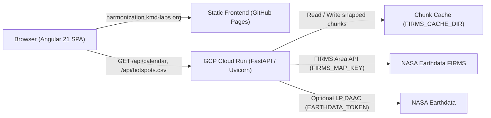

# NASA Wildfires Model — Harmonized MODIS & VIIRS Burning Activity Calendar

https://github.com/user-attachments/assets/e770dcb0-54ce-4a51-8986-8c0f6bb6b9ff

> **Live Application:** [harmonization.kmd-labs.org](https://harmonization.kmd-labs.org/)  
> **Hackathon Challenge:** **2026 NASA Space Apps Challenge** — [Challenge 15: Harmonization of MODIS and VIIRS Hot Spots](https://www.spaceappschallenge.org/2026/challenges/modis-and-viirs-hot-spots/)  
> **Built by:** **KMD Labs** ([kmd-labs.org](https://kmd-labs.org))

A scientifically validated **Burning Activity Calendar** and Earth Observation analytics platform that reconciles over 25 years of active-fire detections across **MODIS (Terra & Aqua, 1 km)** and **VIIRS (Suomi NPP, NOAA-20 & NOAA-21, 375 m)** into one consistent, drift-corrected time series from **November 2000 to the present**.

---

## Key Results at a Glance

- **26+ Years on a Single Scale:** Seamless monthly and daily fire activity from `2000-11` onward, chained across Terra, Aqua, Suomi NPP, NOAA-20, and NOAA-21.
- **Zero 2012 Sensor-Entry Jump:** Naive summation jumps **4.64×** when VIIRS launches; harmonization **v4** reduces the median jump to **1.0×**.
- **Validated on 22 Regions across 6 Continents and 8 Biomes:** Predicting raw MODIS strictly from VIIRS in blocked $k$-fold validation achieves **1.1%** median $|\text{bias}|$ (2012–2019) and **2.7%** (2023+ — within 10% in **19/22** regions and within 20% in **22/22**), with **0.9** calibrated 90% interval coverage. See the full [v4 Validation Report](docs/validation/global-v4/report.md) and its [scope and limits](#2-multi-regional-validation-summary).
- **Orbit-Drift & End-of-Mission Ready:** Explicitly models MODIS orbital drift directly from `acq_time` (Terra `-1.36 h`, Aqua `+1.39 h` median shift) and chains NOAA-20/NOAA-21 to Suomi NPP for continuity beyond Suomi NPP's November 2026 end.

---

## Table of Contents

- [The Challenge & Our Solution](#the-challenge--our-solution)
  - [1. Cross-Sensor Harmonization Engine (`backend/`)](#1-cross-sensor-harmonization-engine-backend)
  - [2. Multi-Regional Validation Summary](#2-multi-regional-validation-summary)
  - [3. Interactive Burning Activity Calendar (`src/`)](#3-interactive-burning-activity-calendar-src)
- [Architecture & Performance](#architecture--performance)
- [API Reference](#api-reference)
- [Local Development & Verification](#local-development--verification)
- [Team](#team)

---

## The Challenge & Our Solution

This repository is our solution to [Challenge 15 — Harmonization of MODIS and VIIRS Hot Spots](https://www.spaceappschallenge.org/2026/challenges/modis-and-viirs-hot-spots/) in the **2026 NASA Space Apps Challenge**.

**The Problem:** As MODIS approaches the end of its operational life, long-term wildfire monitoring depends on bridging MODIS (`1 km`) with higher-resolution VIIRS instruments (`375 m` across `S-NPP`, `NOAA-20`, and `NOAA-21`). Directly summing detections produces an artificial 4–5× spike in 2012 and distorts historical trends due to differing sensitivity, pixel resolution, and drifting satellite overpass schedules.

**Our Solution:** We pair a physical-statistical harmonization engine with an immediate, full-viewport interactive calendar and 2D/3D globe experience:

### 1. Cross-Sensor Harmonization Engine (`backend/`)

The backend converts multi-satellite NASA FIRMS hotspot counts into consistent **MODIS-equivalent units** (Terra + Aqua on their nominal orbits):

1. **QA Filtering & Static Heat Masking:** Retains presumed vegetation fires (`type == 0`), drops low-confidence retrievals, and masks persistent industrial, gas-flare, and volcanic sources (including 1-pixel spatial dilation for NRT geolocation jitter).
2. **H3 Spatiotemporal Cube & Overpass Tracking:** Bins detections across all five platforms (`TERRA`, `AQUA`, `SNPP`, `NOAA20`, `NOAA21`) into **H3 hexagonal cells** and calendar months while accounting for day/night regimes and satellite outage exposure.
3. **Sensing-Power Efficiency & Drift Law (`harmonization4.py`):** Estimates each platform's relative detection efficiency $e_{p,\text{cell},\text{month}}$ with hierarchical shrinkage (`cell -> region & calendar month -> prior`) and corrects for measured MODIS orbital drift and VIIRS inter-satellite chaining:

   $$H_{\text{cell},\text{month}} = \frac{\sum_p N_{p,\text{cell},\text{month}}}{\sum_p \left(e_{p,\text{cell},\text{month}} \cdot \text{exposure}_{p,\text{month}}\right)}$$

   Selectable engine versions (`HARMONIZATION=v1|v2|v3|v4` in [`backend/harmonization_select.py`](backend/harmonization_select.py)) span the baseline model through day/night + FRP stratification (`v2`), separated small-fire attribution (`v3`), and the production MODIS orbit-drift model (`v4`). Methodology notes are documented in [`docs/harmonization.md`](docs/harmonization.md).
4. **Uncertainty, Anomalies & External Witness Checks:** Delivers calibrated 90% quasi-Poisson confidence intervals, leave-one-out multi-year baselines (Z-scores, percentiles, % of median), blocked $k$-fold cross-validation, and burned-area seam tests against NASA LP DAAC (`MCD64A1` / `VNP64A1`).

### 2. Multi-Regional Validation Summary

Across **22 fire-prone regions** spanning boreal forests, tropical forests, savannas, temperate zones, grasslands, croplands, Mediterranean shrublands, and peatlands ([full report](docs/validation/global-v4/report.md)):

| Metric (Median Across 22 Regions) | Naive Sum (`MODIS + VIIRS`) | Harmonized `v3` | Harmonized `v4` (Production) |
|---|---|---|---|
| **2012 VIIRS-Entry Jump** (`1.0×` = seamless) | `4.64×` | `1.0×` | **`1.0×`** |
| **k-fold $\|\text{Bias}\|$ (2012–2019, VIIRS → MODIS)** | — | `2.8%` | **`1.1%`** *(better in 19/22)* |
| **k-fold $\|\text{Bias}\|$ (2023+, VIIRS → MODIS)** | — | `4.0%` | **`2.7%`** *(better in 13/22)* |
| **Forward $\|\text{Bias}\|$ (fit $\le 2023 \rightarrow 2025$)** | — | `11.5%` | **`8.3%`** *(better in 13/22)* |
| **Calibrated 90% Interval Coverage** | — | `0.9` | **`0.9`** |

**Scope and limits.** This is a multi-regional validation, not wall-to-wall global coverage. Because of the time constraints of the hackathon, we validated 22 hand-picked fire-prone boxes (3–6° each) in one overnight run instead of a random, biome-stratified sample of the whole globe. NOAA-21 is missing in 8 of the regions (the FIRMS Area API rate limit stopped the download), there is no region yet in Central Africa, the tundra, China or the Middle East, the data end in 2025, and the burned-area witness (MCD64A1) is itself a MODIS product. The [validation script](scripts/validation/global_validation.py) is resumable and ready for a larger sample.

### 3. Interactive Burning Activity Calendar (`src/`)

Built with **Angular 21**, **Three.js**, **D3-geo / TopoJSON**, and `@kmd/design-system`, [`harmonization.kmd-labs.org`](https://harmonization.kmd-labs.org/) opens straight into a `100vw × 100vh` map and 3D globe workspace with zero modal friction:

- **Flexible Area of Interest (AOI):** Draw custom polygons or rectangles directly on the map/globe, enter exact `W / S / E / N` coordinates, or select countries and curated demo regions.
- **Sensor-Aware 3-Way Switcher:** Query any range from `2000-11-01` onward across **VIIRS 375m**, **MODIS 1km**, or **VIIRS + MODIS** (automatically locking to **VIIRS + MODIS** when spanning the `2012-01-20` VIIRS launch).
- **Multi-Scale Analytics:** Explore interactive Year × Month and Daily Burning Activity Calendars, comparative annual curves, top-year rankings, and multi-year seasonal anomalies.
- **Accessible & Export-Ready:** CVD-safe color ramps (`Inferno`, `Viridis`, `Cividis`, `Plasma`, `Ember`) across 2D/3D heatmaps and calendars, with one-click **CSV**, **JSON**, **SVG**, and **PNG** exports.

---

## Architecture & Performance

A split static-frontend / stateful-cache-backend architecture delivers fast global loading, offline resilience, and strict server-side credential isolation:



- **Frontend ([harmonization.kmd-labs.org](https://harmonization.kmd-labs.org/)):** Built from `src/` and configured to talk to the Cloud Run API in [`src/app/core/services/wildfire-data.service.ts`](src/app/core/services/wildfire-data.service.ts) (with local override support during development).
- **Backend (`GCP Cloud Run` · `europe-west1`):** Containerized via [`backend/Dockerfile`](backend/Dockerfile) (`python:3.12-slim` + `uvicorn backend.server:app`). Incoming queries are split by satellite epoch into 5-day FIRMS chunks (`FIRMS_CHUNK_DAYS=5`) on a `0.5°` cache grid—immutable science-quality chunks (`*_SP`) are cached permanently while near-real-time chunks (`*_NRT`) refresh every `6h`. Downloads are on demand: a query fetches only the chunks of its own bbox × date range (no background backfill of other years), answering HTTP `202` with progress until they are in; months never downloaded are returned as `null` (missing, see `series.dataCoverage`), not as zero fires.
- **Three-Layer Caching & Instant Paint:** Combines a bundled Iberia fallback snapshot for immediate first paint, browser `IndexedDB` + Service Worker caching (`OfflineCacheService` & `src/sw.js`) for offline continuity, and server-side `0.5°` regional chunk reuse so sub-queries avoid redundant NASA FIRMS API calls.
- **Production Guardrails:** `FIRMS_MAP_KEY` and `EARTHDATA_TOKEN` remain strictly server-side in Cloud Run. Public endpoints are read-only `GET` routes enforcing `CORS_ORIGINS` allowlisting and bounding-box area caps (`MAX_BBOX_DEG2 = 8000` deg² for FIRMS, `BURNED_AREA_MAX_DEG2 = 400` deg² for LP DAAC tiles).

---

## API Reference

| Endpoint | Description |
|---|---|
| `GET /api/health` | Service health, cached region inventory, and upstream credential readiness |
| `GET /api/calendar?bbox=W,S,E,N&from=YYYY-MM&to=YYYY-MM` | `200` harmonized time series, calendar matrices, H3 cells, pixels, climatology, and validation metrics; `202` while chunk downloads are in progress |
| `GET /api/hotspots.csv?bbox=W,S,E,N&from=YYYY-MM-DD&to=YYYY-MM-DD` | Downloadable hotspot CSV including `used_in_calendar` QA and harmonization weights |
| `GET /api/burned-area?bbox=W,S,E,N&product=MCD64A1&from=YYYY-MM&to=YYYY-MM` | Monthly burned area (`km²`) and cross-sensor seam comparison (requires server-side `EARTHDATA_TOKEN`) |

---

## Local Development & Verification

### 1. Backend (Python 3.12+)

```bash
pip install -r backend/requirements.txt

# Optional: seed offline Iberian Peninsula FIRMS cache (no API key required)
python -m backend seed

# Start FastAPI server at http://127.0.0.1:8000 (Swagger UI at /docs)
python -m backend serve --port 8000

# Run backend test suite
python -m pytest backend/tests -q
```

### 2. Frontend (Node.js 22+)

```bash
npm install --legacy-peer-deps

# Start Angular dev server (or `npm run dev` to launch backend + frontend together)
npm start

# Production build
npm run build
```

---

## Team

Built by **KMD Labs** ([kmd-labs.org](https://kmd-labs.org) · [hello@kmd-labs.org](mailto:hello@kmd-labs.org)) for the **2026 NASA Space Apps Challenge**.
