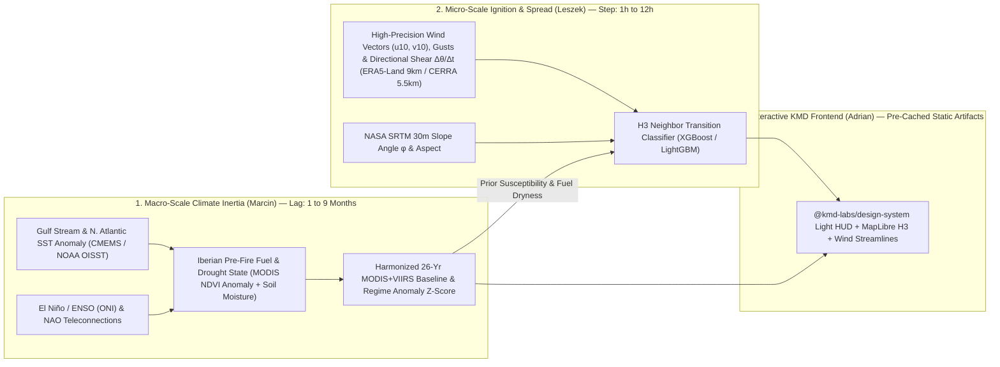
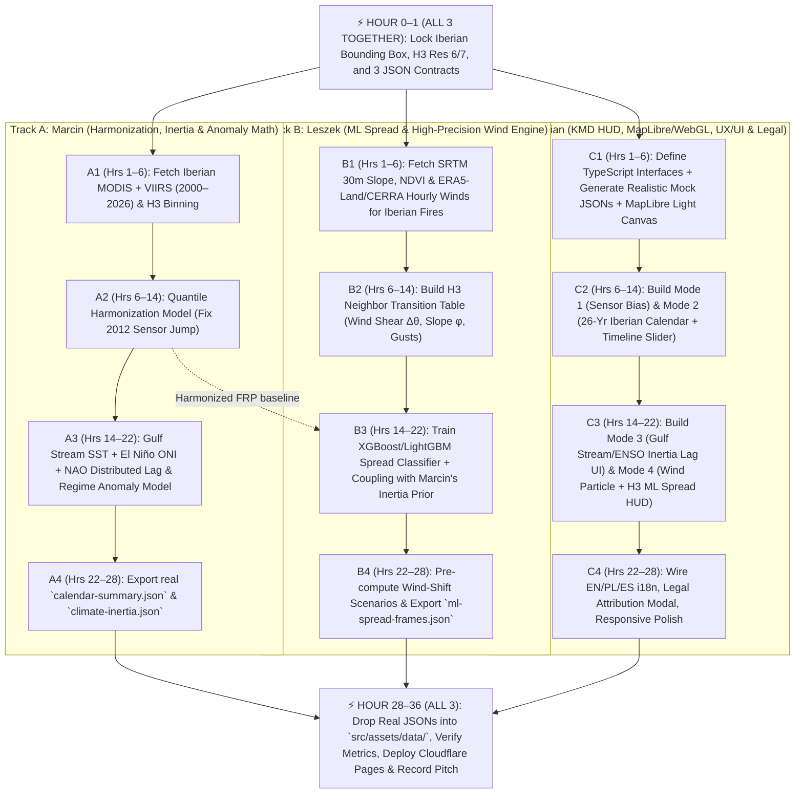

# NASA Space Apps 2026 Master Plan: Iberian Wildfire Harmonization, Ocean-Atmosphere Inertia & Wind-Driven Spread Model

**Challenge:** Harmonization of MODIS and VIIRS Hot Spots  
**Geographic Focus:** **Iberian Peninsula (*Półwysep Iberyjski* — Spain & Portugal)**  
**Core Scientific Concept:** A unified 26-year (2000–2026) harmonized MODIS + VIIRS fire activity and anomaly calendar for the Iberian Peninsula, coupled with a **Two-Scale Predictive Engine**:
1. **Macro-Scale Climate Inertia Engine (Months-to-Seasons Lag):** Quantifies how global ocean-atmosphere teleconnections with massive thermal inertia (*bezwładność*)—specifically the **Gulf Stream / North Atlantic SST (AMOC)**, **El Niño–Southern Oscillation (ENSO)**, and **North Atlantic Oscillation (NAO)**—pre-condition Iberian vegetation fuel load (`NDVI`) and drought anomalies months in advance.
2. **Micro-Scale High-Precision Wind & Terrain Spread Model (Hourly):** An H3 hexagonal graph machine learning model (XGBoost/LightGBM) that combines the macro-climate baseline with **rapidly shifting local Iberian wind vectors** (Atlantic westerlies, dry continental *Levante*/*Poniente*, Foehn winds, and directional wind shear $\Delta\theta/\Delta t$) and **NASA SRTM 30m topography** to predict hourly/overpass fire spread vectors.

---

## 1. Team Roster & Core Responsibilities

| Team Member | Background & Strengths | Primary Track & Ownership |
| :--- | :--- | :--- |
| **Leszek Michalak** | Data Science Expert, Machine Learning & Predictive Model Creation | **Track B — Spatial-Temporal ML & High-Precision Wind Spread Engine:** H3 neighbor transition formulation, high-resolution wind vector & directional shift feature engineering (ERA5-Land / CERRA + SRTM slope + NDVI), XGBoost/LightGBM training, SHAP explainability, and dynamic wind-shift scenario export (`ml-spread-frames.json`). |
| **Marcin Derewońko** | Data Science, Custom Statistical Models, Anomaly Detection & Finance/Econometrics | **Track A — Sensor Harmonization, Oceanic Inertia & Anomaly Detection:** MODIS (`MCD14ML`) + VIIRS (`VNP14IMGML`) quantile harmonization on H3 grid; econometric/financial-style Distributed Lag & Regime-Switching Anomaly Model linking **Gulf Stream SST + El Niño (ONI) + NAO** inertia to Iberian fire regimes (`calendar-summary.json`, `climate-inertia.json`). |
| **Adrian Kulik** | Artificial Intelligence, Fullstack Architecture & UX/UI (`@kmd-labs/design-system`) | **Track C — Interactive KMD HUD, WebGL/MapLibre Visualization, Legal Compliance & Deployment:** JSON data contracts & mock generator, MapLibre/Canvas H3 & animated wind-particle renderer, 4-mode visualization HUD, `EN/PL/ES` internationalization, legal attribution glossary, and Cloudflare Pages deployment. |

---

## 2. Scientific Architecture: Why the Iberian Peninsula + Gulf Stream / El Niño + Local Wind?

### A. Why the Iberian Peninsula (*Półwysep Iberyjski*) is the Ultimate Testbed
The Iberian Peninsula (`[-9.6°W, 36.0°N, 3.4°E, 43.8°N]`) is Europe's premier wildfire hotspot and sits directly at the intersection of the North Atlantic oceanic conveyor and the subtropical Mediterranean ridge:
- **Sub-AOI 1 (Atlantic/Lusitanian Fire Regime — Central & Northern Portugal / Galicia & Zamora):** E.g., *Pedrógão Grande (2017)* and *Sierra de la Culebra (2022)*. Driven by wet Atlantic winters (massive biomass accumulation) followed by sudden marine-to-continental wind reversals and extreme thermal lows.
- **Sub-AOI 2 (Mediterranean & Guadalquivir Valley Regime — Andalusia / Valencia / Eastern Spain):** Driven by multi-year drought cycles, dry *Poniente* (westerly Foehn wind warming sharply as it descends toward the Mediterranean coast), and *Levante* wind shifts.

### B. Bridging Global Oceanic Inertia (*Bezwładność*) and Rapid Local Wind Shifts
A standard wildfire model fails if it treats global climate indices and local weather on the same timescale. Our architecture separates them into **two physically coupled timescales**:



1. **Why Gulf Stream & El Niño Have High Inertia (3–9 Month Lag):**
   - Ocean heat content in the **Gulf Stream / North Atlantic Subpolar & Subtropical Gyres** and tropical Pacific **El Niño (ENSO)** evolves slowly over months.
   - **The "Whip-Lash" Fuel Effect:** Positive North Atlantic SST anomalies off Portugal/Spain combined with El Niño/NAO shifts alter winter/spring precipitation tracks across Iberia. A wet winter/spring (Lag $-6$ to $-3$ months) triggers explosive growth of fine shrubs and grasses. When a summer Azores High blocking ridge locks in (Lag $-1$ to $0$ months), that excess biomass desiccates into a high-volatility tinderbox (`NDVI` drop rate $\Delta \text{NDVI} / \Delta t$).
   - Marcin's model captures this **lagged memory** using financial econometrics techniques (**Almon / Polynomial Distributed Lag Models**, **Cross-Wavelet Coherence**, and **Regime-Switching Volatility / Mahalanobis Anomaly Scores**).
2. **Why Wind Must Be High-Precision & High-Frequency (1h–12h Resolution):**
   - Once the macro-climate sets the fuel anomaly, global indices cannot tell you which village burns in the next 6 hours.
   - Iberian mega-fires are notoriously governed by **sudden wind direction changes ($\Delta \theta / \Delta t$)**—such as a sea-breeze collapse, a cold-front passage rotating winds by $90^\circ$ (turning a narrow fire flank into a massive $15\text{ km}$ head fire), or terrain-channeled Foehn winds across steep river canyons (Douro, Tagus, Mondego).
   - Leszek's ML model encodes not just static wind speed, but **wind-to-hexagon alignment** $v \cdot \cos(\theta_{\text{wind}} - \theta_{H_0 \to H_i})$, **6-hour wind directional variance (angular shear)**, **95th-percentile wind gusts**, and **wind $\times$ uphill SRTM slope interaction**.

---

## 3. Open Datasets, Caching Strategy & Legal Compliance

To ensure the application is **100% legally sound** for public hosting, hackathons, and commercial KMD Labs portfolio use, all data must come from permissive open government/scientific licenses and be **pre-aggregated and cached as static H3 JSON/GeoJSON artifacts**.

### A. Legally Verified Open Datasets Catalog

| Domain | Dataset Name & Official ID | Spatial / Temporal Resolution | Legal License & Commercial/Public Right | Can We Cache & Redistribute Statically? | Required Attribution in UI |
| :--- | :--- | :--- | :--- | :--- | :--- |
| **Active Fire Hotspots (2000–2026)** | **NASA FIRMS MODIS (`MCD14ML` C6.1)** & **VIIRS (`VNP14IMGML` / `VJ114IMGML`)** | $1\text{ km}$ (MODIS) & $375\text{ m}$ (VIIRS) / $12\text{h}$ overpasses | **US Gov Public Domain** (17 U.S.C. § 105; NASA Earth Science Data Policy) | **YES — Unrestricted.** Pre-aggregate into H3 cells and commit static JSON. | *"We acknowledge the use of data from NASA's Fire Information for Resource Management System (FIRMS), part of NASA's Earth Science Data Systems (ESDS)."* |
| **Topography & Slope** | **NASA SRTM Digital Elevation 30m (`USGS/SRTMGL1_003`)** or **NASADEM** | $30\text{ m}$ static | **US Gov Public Domain** (NASA / USGS) | **YES — Unrestricted.** Cache mean elevation, slope $\phi$, and aspect per H3 cell. | *"Topographic data provided by NASA/USGS Shuttle Radar Topography Mission (SRTM)."* |
| **Vegetation & Fuel Dryness** | **NASA MODIS/VIIRS 16-Day NDVI (`MOD13Q1 v061` / `VNP13A1`)** | $250\text{ m}$–$500\text{ m}$ / $16\text{-day}$ | **US Gov Public Domain** (NASA LP DAAC) | **YES — Unrestricted.** Cache 26-year H3 seasonal baseline & anomalies. | *"Vegetation indices from NASA EOSDIS Land Processes DAAC (MOD13Q1 / VNP13A1)."* |
| **High-Precision Iberian Winds** | **Copernicus ECMWF ERA5-Land Hourly (`ECMWF/ERA5_LAND/HOURLY`)** & **CERRA ($5.5\text{ km}$ European Reanalysis)** | $9\text{ km}$ (ERA5-Land) or $5.5\text{ km}$ (CERRA) / **Hourly** ($u_{10}, v_{10}$, gusts) | **Copernicus Free & Open License (CC-BY 4.0 equivalent)** | **YES — Unrestricted** (including commercial use & derivative JSON caching). | *"Contains modified Copernicus Climate Change Service (C3S) information [2026]. Neither the European Commission nor ECMWF is responsible for any use made of it."* |
| **Gulf Stream & Atlantic SST** | **NOAA OISST v2.1 (`NOAA/CDR/OISST/V2_1`)** & **Copernicus Marine (CMEMS Atlantic Iberic-Biscay-Irish SST / Currents)** | $0.25^\circ$ daily/monthly SST anomaly & Gulf Stream index | **US Gov Public Domain (NOAA)** / **Copernicus CC-BY 4.0** | **YES — Unrestricted.** Cache monthly time series & spatial SSTA grids. | *"Sea Surface Temperature & Gulf Stream indices from NOAA NCEI OISST v2.1 and Copernicus Marine Service (CMEMS)."* |
| **El Niño (ENSO) & NAO Indices** | **NOAA CPC Oceanic Niño Index (ONI / Niño 3.4)** & **Hurrell/NOAA NAO Index** | Monthly global teleconnection time series (1950–2026) | **US Gov Public Domain (NOAA CPC / PSL)** | **YES — Unrestricted.** Embed full 26-year JSON time series in repo. | *"Climate teleconnection indices (ENSO ONI, NAO) provided by NOAA Climate Prediction Center."* |

### B. Critical Legal Trap to Avoid & How Our Caching Solves It
> [!IMPORTANT]
> **Legal Guardrail on Weather APIs & Map Tiles:**
> 1. **Avoid calling Open-Meteo's free public API (`api.open-meteo.com`) directly from the browser in production**, because Open-Meteo's hosted API wrapper carries a **CC BY-NC 4.0 (Non-Commercial)** term on the hosted service, whereas the underlying **ECMWF ERA5-Land** and **NOAA** datasets fetched via **Google Earth Engine (`ECMWF/ERA5_LAND/HOURLY`)** or **Copernicus CDS (`cdsapi`)** are **100% open for both commercial and non-commercial use**.
> 2. **Our Caching Architecture (`scripts/data-pipeline/` -> `src/assets/data/`):** We run Python scripts offline to ingest raw NASA FIRMS, NASA SRTM, NASA MODIS NDVI, NOAA ENSO/SST, and Copernicus ERA5-Land data, aggregate them into **Uber H3 hexagons (Resolutions 6 & 7)**, and export compressed static JSON files into `src/assets/data/`.
>    - **Zero runtime external API calls** (except open vector map tiles with proper attribution).
>    - **Zero user PII / cookies** (only functional `localStorage` key `nasa-wildfires.lang` per `AGENTS.md` — 100% GDPR/ePrivacy exempt without a cookie banner).
>    - **Mandatory Legal & Scientific Attribution Section** built directly into the KMD Glossary/About Popup (`PopupService`).

---

## 4. What to Tackle First & Parallel Execution Streams

### The Golden Rule of Parallelism: "Lock the JSON Contracts in Hour 1"
All three team members can work at **100% parallel capacity with zero blocking** as soon as the **H3 Resolution and 3 JSON schemas** are agreed upon in the first 45 minutes.



---

## 5. Detailed Task Breakdown & Assignments

### Shared Kickoff Task (First 45 Minutes — Leszek, Marcin & Adrian Together)
- [ ] **TASK-00 (All):** Agree on the Iberian Peninsula bounding box (`lon: [-9.6, 3.4], lat: [36.0, 43.8]`), regional H3 resolution (**H3 Res 5/6** for full-peninsula 26-year calendar overview to keep JSON `< 1.5 MB`; **H3 Res 7** $\approx 5.16\text{ km}^2$ for the localized high-precision wind-spread ML case studies in **Pedrógão Grande 2017** and **Sierra de la Culebra / Zamora 2022**), and freeze the TypeScript/JSON schemas for:
  1. `src/assets/data/calendar-summary.json` (26-year weekly MODIS, VIIRS, Harmonized FRP & Anomaly scores)
  2. `src/assets/data/climate-inertia.json` (Monthly 2000–2026 Gulf Stream SST anomaly, El Niño ONI, NAO, lagged cross-correlation curves & regime states)
  3. `src/assets/data/ml-spread-frames.json` (Hourly/12h H3 burning cells, wind vectors $[u_{10}, v_{10}]$, wind shift $\Delta\theta$, SRTM slope, and neighbor ignition probabilities across 3 wind scenarios)

---

### Track A — Marcin Derewońko (Sensor Harmonization, Oceanic Inertia & Anomaly Detection)

> **Why this fits Marcin:** Harmonizing two noisy satellite sensors with structural breaks (the 2012 VIIRS launch) and modeling multi-month lagged macro-climate regimes (Gulf Stream + El Niño $\to$ Iberian drought/fuel buildup $\to$ tail-risk wildfire outbreak) is mathematically identical to **financial regime-switching, volatility clustering, non-stationary time-series econometrics, and tail-anomaly detection**.

- [ ] **MARCIN-01 (Priority 1 — Data Ingestion & H3 Spatial Binning):**
  - Pull 2000–2026 NASA FIRMS MODIS (`MCD14ML`) and 2012–2026 VIIRS (`VNP14IMGML`) active fire records for the Iberian Peninsula (`Portugal + Spain`).
  - Map all detections to Uber H3 cells and aggregate weekly counts, total Fire Radiative Power ($\sum \text{FRP}$), and 90th-percentile $\text{FRP}$.
- [ ] **MARCIN-02 (Priority 1 — MODIS/VIIRS Quantile Harmonization Engine):**
  - Solve the **2012 Sensor Jump Problem** (where raw hotspot counts jump $\sim 3.5\times$–$5\times$ when VIIRS $375\text{ m}$ comes online alongside MODIS $1\text{ km}$).
  - Using the 2012–2026 overlap period across Iberian biomes (Atlantic eucalyptus/pine vs. Mediterranean sclerophyllous scrub), fit a conditional **Empirical Quantile Mapping (EQM) / Zero-Inflated Negative Binomial scaling model**:
    $$\hat{Y}_{\text{Harmonized}}(h, t) = F_{\text{VIIRS}}^{-1}\left(F_{\text{MODIS}}\left(Y_{\text{MODIS}}(h, t) \mid \text{Biome}, \text{Season}\right)\right)$$
  - Backcast 2000–2011 MODIS records into VIIRS-equivalent units and generate the "Naive Unharmonized vs. Harmonized Baseline" comparison curve.
- [ ] **MARCIN-03 (Priority 2 — Gulf Stream & El Niño Inertia / Distributed Lag Model):**
  - Fetch monthly 1999–2026 **Gulf Stream / Iberian Margin SST Anomaly** (NOAA OISST v2.1 / Copernicus Marine North Atlantic box), **El Niño ONI (Niño 3.4)**, and **NAO Index**.
  - Build a **Distributed Lag / Vector Autoregressive (VAR) & Cross-Correlation Model** (lags $k = 0 \dots 12$ months) showing how:
    1. Winter/Spring Atlantic SST & ENSO/NAO anomalies (Lag $-6$ to $-3$ months) drive vegetation biomass growth (`NDVI` positive anomaly).
    2. Late-spring/summer Gulf Stream/Azores blocking highs (Lag $-2$ to $0$ months) trigger rapid fuel desiccation ($\Delta \text{NDVI} < 0$) and extreme fire tail-risk.
- [ ] **MARCIN-04 (Priority 2 — Financial-Style Regime & Tail-Anomaly Detector):**
  - Compute a composite **Iberian Fire Anomaly Index (Z-score & Mahalanobis Distance)** for every week of 2000–2026, classifying each period into regimes (`Baseline`, `Fuel Accumulation Watch`, `Ocean-Atmospheric Inertia Alert`, `Extreme Tail Anomaly`).
  - Export `calendar-summary.json` and `climate-inertia.json` + validation plots for the Jupyter report.

---

### Track B — Leszek Michalak (High-Precision Wind & Terrain ML Spread Engine)

> **Why this fits Leszek:** Formulating wildfire propagation as a spatio-temporal directed graph transition problem on hexagonal grids, engineering directional physics features (wind shear, terrain aspect/slope alignment), and training calibrated gradient-boosted trees with cross-regional validation plays directly to core ML engineering strengths.

- [ ] **LESZEK-01 (Priority 1 — Micro-Scale Wind, Topography & Fuel Feature Pipeline):**
  - Select 2 landmark Iberian fire sequences for deep high-resolution H3 (Res 7) modeling:
    - **Case 1 (Train / Cross-Validation):** *Sierra de la Culebra / Zamora & Galicia Fires (Spain, June–July 2022)* — extreme dry wind shifts and topographic channeling.
    - **Case 2 (Holdout Validation):** *Pedrógão Grande / Central Portugal Complex (June 2017 or 2022–2024 Castro Marim / Odemira fires)* — notorious for sudden convective/synoptic wind rotation.
  - Extract static **NASA SRTM 30m** elevation, slope $\phi$, and aspect per H3 cell, plus pre-fire 16-day **MODIS `MOD13Q1` NDVI**.
  - Extract **hourly high-precision wind fields ($u_{10}, v_{10}$, 10m wind gusts)** from **Copernicus ERA5-Land ($9\text{ km}$)** or **CERRA ($5.5\text{ km}$)** via Google Earth Engine / Copernicus CDS.
- [ ] **LESZEK-02 (Priority 1 — Directional Wind Physics & Inertia Feature Engineering):**
  - Construct the directed neighbor transition dataset $(H_0 \to H_i, i \in \{1..6\})$ across consecutive satellite steps ($t \to t + \Delta t$):
    - **Wind Alignment Force:** $W_{\text{align}} = v_{\text{wind}} \cdot \cos(\theta_{\text{wind}}(t) - \theta_{H_0 \to H_i})$, where $\theta_{H_0 \to H_i}$ is the azimuth from burning cell $H_0$ to neighbor $H_i$.
    - **Wind Directional Shear / Volatility (Changing Wind Direction):** $\Delta \theta_{\text{wind}} = |\theta_{\text{wind}}(t) - \theta_{\text{wind}}(t - 3\text{h})|$ and circular variance over the window—capturing how sudden wind shifts widen the fire flank!
    - **WindGust Ratio & Slope Synergy:** $\tan(\phi_{H_0 \to H_i}) \times \max(0, W_{\text{align}})$ (Rothermel-inspired empirical interaction between uphill slope and tailwind).
    - **Macro-Inertia Prior (from Marcin):** Inject Marcin's lagged Gulf Stream / ENSO fuel dryness anomaly score as a contextual macro-feature.
- [ ] **LESZEK-03 (Priority 2 — XGBoost / LightGBM Training, Calibration & SHAP Explainability):**
  - Train a calibrated `XGBClassifier` / `LGBMClassifier` predicting $P(\text{Ignition}_{H_i, t+\Delta t} \mid \text{Features})$.
  - Compute **ROC-AUC, PR-AUC, Brier Score**, and **SHAP Feature Importance** (proving to judges that directional wind alignment, wind shift $\Delta\theta$, SRTM slope, and lagged oceanic fuel dryness drive the predictions).
- [ ] **LESZEK-04 (Priority 2 — Interactive "What-If" Wind Rotation Scenarios & Export):**
  - Pre-compute 4 dynamic wind scenarios for the validation fire and export `ml-spread-frames.json` + static HTML notebook `notebook-report.html`:
    1. `Actual Historical Winds` (ground truth ERA5-Land hourly rotation)
    2. `Atlantic Westerly Surge (+45° / 2x Gust)`
    3. `Dry Continental Levante / Foehn Shift (East-to-West reversal)`
    4. `+2°C Gulf Stream / El Niño Extreme Drought Baseline` (showing how oceanic inertia amplifies spread probability under the same wind)

---

### Track C — Adrian Kulik (AI, Fullstack Development, UX/UI & Legal Architecture)

> **Why this fits Adrian:** Designing an editorial-grade scientific visualization HUD on `@kmd-labs/design-system`, rendering high-fps H3 grids and animated wind vectors in MapLibre/Canvas, enforcing strict `AGENTS.md` Light Theme & i18n rules, and ensuring rock-solid deployment and legal compliance.

- [ ] **ADRIAN-01 (Priority 1 — TypeScript Contracts, Mock Data Generator & MapLibre Setup):**
  - Create TypeScript interfaces in `src/app/core/models/wildfire.model.ts` matching `calendar-summary.json`, `climate-inertia.json`, and `ml-spread-frames.json`.
  - Write a quick script (`scripts/generate-mock-data.mjs`) to populate `src/assets/data/` with realistic Iberian H3 mock data so UI development starts in **Hour 1** without waiting for Python notebooks.
  - Integrate **MapLibre GL JS** (`maplibre-gl`) centered on the Iberian Peninsula (`[-3.7, 40.2]`, zoom `5.8`) using a clean KMD Light Theme Positron/topographic style (`ThemeService.getTokenColor()`).
- [ ] **ADRIAN-02 (Priority 1 — Canonical KMD 3-Zone HUD & 4 Visualization Modes):**
  - Follow `AGENTS.md` strictly: `100vw × 100vh` canvas, Top-Left `<app-brand>` + `EN/PL/ES` language selector, Top-Right view switcher `<app-dropdown>`, Bottom Dock `.dock-wrap` with `<app-timeline-slider>`.
  - Wire the 4 primary modes in the Top-Right View Switcher:
    1. **Mode 1: Harmonized 26-Year Iberian Calendar (2000–2026)** — Interactive $52\text{ weeks} \times 26\text{ years}$ heatmap dock + H3 map layer with a 1-click **"2012 Sensor Jump Toggle"** comparing raw MODIS+VIIRS against Marcin's harmonized baseline.
    2. **Mode 2: Gulf Stream & El Niño Inertia Explorer** — Dual-panel visualization showing North Atlantic / Gulf Stream SST anomalies and El Niño (ONI) lag curves alongside Iberian fuel dryness (`NDVI`) and fire regime states.
    3. **Mode 3: High-Precision Wind & ML Spread Simulator** — Zooms into the Iberian validation fire (Pedrógão Grande / Sierra de la Culebra), rendering animated wind-vector streamlines/arrows, burning H3 hexagons, and Leszek's 6-neighbor ML ignition probability cones, with a **Bottom Dock Wind Scenario Switcher** (`Actual Wind`, `Atlantic Surge`, `Levante Reversal`, `El Niño Drought Boost`).
- [ ] **ADRIAN-03 (Priority 2 — Legal Attribution Modal, Glossary & Multilingual `EN/PL/ES`):**
  - Update `src/app/core/i18n/i18n.types.ts`, `en.ts`, `pl.ts` (and `es.ts` for Iberian relevance!) with zero hardcoded strings.
  - Build the **Scientific Glossary & Legal Data Compliance Modal** via `PopupService` documenting:
    - Exact NASA (`MCD14ML`, `VNP14IMGML`, `SRTMGL1_003`, `MOD13Q1`), NOAA (`OISST v2.1`, `CPC ONI`), and Copernicus (`ERA5-Land`, `CMEMS`) citations.
    - Clear explanation of **Oceanic Inertia (*Bezwładność*) vs. Synoptic Wind Shear**.
    - Direct button to open Leszek & Marcin's exported `notebook-report.html`.
- [ ] **ADRIAN-04 (Priority 2 — Performance, SEO & Cloudflare Pages CI/CD):**
  - Verify Lighthouse performance, mobile/tablet responsive breakpoints (`@include respond-to("mobile")`), and deploy live to **Cloudflare Pages**.

---

## 6. JSON Data Contract Specifications (Single Source of Truth)

To keep Marcin, Leszek, and Adrian synchronized, all static cached files live in `src/assets/data/`:

### 1. `src/assets/data/calendar-summary.json` (Owner: Marcin)
```json
{
  "metadata": {
    "region": "Iberian Peninsula (ES/PT)",
    "bbox": [-9.6, 36.0, 3.4, 43.8],
    "h3Resolution": 5,
    "years": [2000, 2026],
    "license": "NASA FIRMS Public Domain (MCD14ML, VNP14IMGML) - Harmonized by KMD Labs"
  },
  "weeklySeries": [
    {
      "year": 2017,
      "week": 25,
      "rawModisCount": 412,
      "rawViirsCount": 1890,
      "harmonizedCount": 1945,
      "harmonizedFrpMw": 48210.5,
      "anomalyZScore": 4.2,
      "regime": "EXTREME_TAIL_ANOMALY",
      "activeHexagons": [
        { "h3": "85390cbffffffff", "frp": 3420.0, "anomaly": 3.8, "ndviAnomaly": -0.24 }
      ]
    }
  ]
}
```

### 2. `src/assets/data/climate-inertia.json` (Owner: Marcin)
```json
{
  "lagCorrelations": [
    { "lagMonths": 0, "gulfStreamSstCorr": 0.31, "elNinoOniCorr": 0.14, "naoCorr": -0.42 },
    { "lagMonths": 3, "gulfStreamSstCorr": 0.58, "elNinoOniCorr": 0.49, "naoCorr": -0.35 },
    { "lagMonths": 6, "gulfStreamSstCorr": 0.64, "elNinoOniCorr": 0.61, "naoCorr": 0.38 }
  ],
  "monthlyTimeline": [
    {
      "yearMonth": "2022-07",
      "gulfStreamSstAnomalyC": 1.45,
      "elNinoOni": -0.8,
      "naoIndex": -1.2,
      "iberianNdviAnomaly": -0.31,
      "inertiaRiskIndex": 0.89,
      "harmonizedFireActivity": 4.1
    }
  ]
}
```

### 3. `src/assets/data/ml-spread-frames.json` (Owner: Leszek)
```json
{
  "event": {
    "id": "sierra-de-la-culebra-2022",
    "name": "Sierra de la Culebra & Zamora Mega-Fire (Iberia)",
    "center": [-6.25, 41.92],
    "h3Resolution": 7,
    "metrics": { "rocAuc": 0.91, "prAuc": 0.84, "brierScore": 0.08 }
  },
  "frames": [
    {
      "timestamp": "2022-06-17T15:00:00Z",
      "synopticSummary": { "windSpeedKmh": 42.5, "windDirDeg": 245, "windShear3hDeg": 38, "tempC": 38.4 },
      "cells": [
        {
          "h3": "87390cb12ffffff",
          "state": "BURNING",
          "frp": 820.5,
          "slopeDeg": 18.4,
          "ndviAnomaly": -0.29,
          "windU": 8.4,
          "windV": 5.2,
          "scenarios": {
            "actual": 0.94,
            "atlanticSurge": 0.98,
            "levanteReversal": 0.22,
            "elNinoDroughtBoost": 0.99
          }
        }
      ]
    }
  ]
}
```

---

## 7. Legal & Compliance Checklist (Before Submission / Release)

- [x] **Public Domain / Open Data Only:** NASA FIRMS (`MCD14ML`, `VNP14IMGML`), NASA SRTM (`SRTMGL1_003`), NASA MODIS (`MOD13Q1`), NOAA (`OISST v2.1`, `CPC ONI`), and Copernicus (`ERA5-Land`, `CMEMS`) all permit commercial & non-commercial pre-processing, static caching, and redistribution.
- [x] **No Browser-Side Non-Commercial API Violations:** All meteorological, oceanic, and satellite records are pre-processed offline in Python and served as static cached H3 JSON artifacts from `src/assets/data/`.
- [x] **Mandatory Attribution Display:** Visible data credits in the bottom dock / Legal & Scientific Glossary popup covering NASA ESDIS, Copernicus C3S/CMEMS, NOAA, and `© OpenStreetMap contributors` on the MapLibre canvas.
- [x] **Zero GDPR/PII Overhead:** No third-party tracking scripts or analytics cookies; only functional language state (`localStorage`) as defined in `AGENTS.md`.
